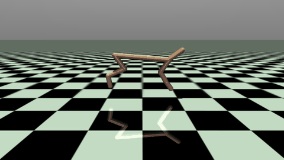
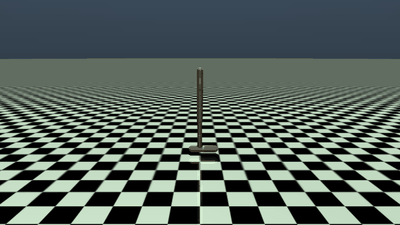
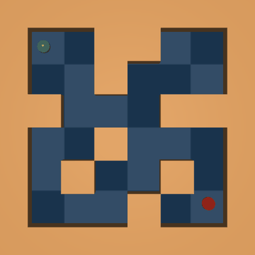
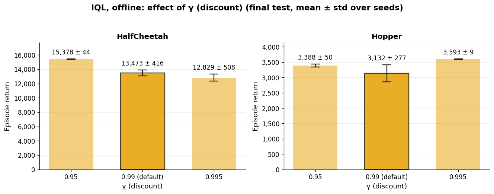
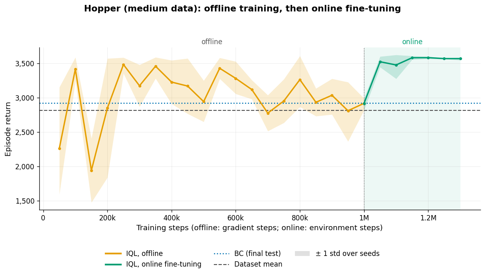

# offline-rl-jax

Behavior cloning (BC), Implicit Q-Learning (IQL) and offline-to-online fine-tuning in JAX, evaluated on four
[Minari](https://minari.farama.org) datasets. All seeds of a configuration train in parallel on one GPU.

<table>
<tr>
<td align="center"><br><sub>HalfCheetah · fine-tuned IQL</sub></td>
<td align="center"><br><sub>Hopper · fine-tuned IQL</sub></td>
<td align="center"><br><sub>PointMaze · IQL</sub></td>
<td align="center"><br><sub>AntMaze · fine-tuned IQL</sub></td>
</tr>
</table>

```
offline-rl-jax/
├── offrl/                  # library
│   ├── algos/              # bc.py, iql.py, finetune.py
│   ├── envs/               # MuJoCo and maze environments
│   ├── data.py  tasks.py   # datasets, labels, task definitions
│   ├── training.py         # vectorized, compiled training loops
│   ├── evaluation.py       # batched evaluation
│   ├── ablation.py         # hyperparameter sweeps
│   └── plotting.py  video.py
├── configs/                # one YAML per task
├── notebooks/              # 01–04: one per task · 05: hyperparameter study
├── scripts/                # run.py (command line) · record_media.py (GIFs)
├── results/  media/        # JSON results, figures, GIFs
└── tests/
```

## Methods

- **BC** — regression of the dataset action on the state.
- **IQL** ([Kostrikov et al., 2022](https://arxiv.org/abs/2110.06169)) — expectile regression of $V(s)$ on the
  Q-values of dataset actions, TD learning of $Q(s,a)$ with target $r + \gamma(1-d)V(s')$, and advantage-weighted
  policy extraction with weights $\min(e^{\beta(Q-V)}, 100)$. No out-of-distribution action is evaluated.
- **Fine-tuning** — the offline IQL networks are trained further on offline plus online data with the same losses;
  exploration samples from the policy with its standard deviation scaled by a temperature.

## Results

Three seeds; evaluation with the mean action; ± is the standard deviation over seeds. Final tests use 20 episodes
per seed (MuJoCo) or 50 (mazes). Minari's MuJoCo datasets have no reference returns, so returns are reported in
absolute terms and as a percentage of the dataset's mean episode return.

### Locomotion: HalfCheetah and Hopper (`medium` data)

| | BC | IQL | IQL, tuned γ | IQL + fine-tuning |
|---|---|---|---|---|
| HalfCheetah · return | 14,454 ± 700 | 13,915 ± 315 | **15,378 ± 44** | 14,246 ± 868 |
| HalfCheetah · % of dataset | 120 | 115 | **127** | 118 |
| HalfCheetah · stuck episodes | 7% | 2% | **0%** | 2% |
| Hopper · return | 2,924 ± 810 | 3,132 ± 277 | **3,593 ± 9** | 3,581 ± 11 |
| Hopper · % of dataset | 104 | 111 | **127** | **127** |
| Hopper · episodes ending in a fall | 37% | 32% | **0%** | 2% |

IQL: $\tau = 0.7$, $\beta = 3$, $\gamma = 0.99$ (HalfCheetah 1.5M steps, Hopper 1M). Tuned: $\gamma = 0.95$
(HalfCheetah) and $\gamma = 0.995$ (Hopper), 1M steps, from the study below. Fine-tuning starts from the default IQL
networks (HalfCheetah 1M environment steps at exploration temperature 0.3; Hopper 300k at 1.0). Stuck: the episode
reaches the time limit with an average forward speed below 0.5 m/s over its last 100 steps.

### Navigation: PointMaze and AntMaze

| | BC | IQL | IQL + fine-tuning |
|---|---|---|---|
| PointMaze · success | 1.00 ± 0.00 | 1.00 ± 0.00 | – |
| PointMaze · success from all start cells | 1.00 ± 0.00 | 1.00 ± 0.00 | – |
| PointMaze · median steps to goal | 278 | **194** | – |
| AntMaze · success | 0.00 ± 0.00 | **0.52 ± 0.03** | 0.48 ± 0.20† |
| AntMaze · success from all start cells | 0.03 ± 0.02 | **0.52 ± 0.08** | 0.45 ± 0.20† |
| AntMaze · episodes ending flipped | 0.29 ± 0.04 | 0.32 ± 0.04 | 0.31 ± 0.12 |
| AntMaze · median steps to goal | – | 530 | **428** |

PointMaze: IQL 300k steps, $\tau = 0.7$, $\beta = 3$. AntMaze: IQL 2M steps, $\tau = 0.9$, $\beta = 10$,
$\gamma = 0.995$; fine-tuning 1M environment steps at temperature 0.3. †Peak 0.73 at 450k steps; the critic
diverged after about 550k steps (see below).

**Findings**

- **Offline RL is decisive when trajectories must be stitched.** No AntMaze trajectory connects the evaluation
  start and goal: BC never reaches the goal, IQL reaches it in 52% of episodes, from start cells across the maze.
- **On single-policy, near-expert data, default IQL is on par with BC** (HalfCheetah, Hopper, PointMaze). With a
  tuned discount it exceeds BC on both locomotion tasks, by 6% on HalfCheetah and 23% on Hopper, where it also
  eliminates falls. On PointMaze, IQL reaches the goal faster.
- **Fine-tuning mainly removes failure modes inherited from the data**: falls on Hopper (32% → 2%) and slower routes
  on AntMaze (median 530 → 428 steps). On HalfCheetah it changes little (13,915 → 14,246).

<p align="center"><br>
<sub>AntMaze: 20 evaluation episodes of BC and IQL (green: goal reached).</sub></p>

## Hyperparameter study

Offline IQL on HalfCheetah and Hopper, one factor at a time around $\gamma = 0.99$, $\beta = 3$ ($\tau = 0.7$, 1M
steps, 3 seeds; `notebooks/05_ablation_mujoco.ipynb`).

| Setting | HalfCheetah | stuck | Hopper | falls |
|---|---|---|---|---|
| γ = 0.95 | **15,378 ± 44** | 0% | 3,388 ± 50 | 17% |
| γ = 0.99 (default) | 13,473 ± 416 | 8% | 3,132 ± 277 | 32% |
| γ = 0.995 | 12,829 ± 508 | 10% | **3,593 ± 9** | 0% |
| β = 1 | 14,899 ± 361 | 0% | 3,268 ± 187 | 25% |
| β = 10 | 13,354 ± 343 | 12% | 3,276 ± 98 | 27% |

- **The discount factor has the largest effect, in opposite directions.** HalfCheetah (dense reward, no
  termination) performs best with a short horizon ($\gamma = 0.95$, about 20 steps) and learns fastest with it; the final TD
  loss grows with the horizon (0.05, 1.8 and 7.2 for $\gamma$ = 0.95, 0.99, 0.995). On Hopper, $\gamma = 0.995$
  (about 200 steps) removes the falls without environment interaction, the same effect as online fine-tuning. This is
  consistent with the falls occurring about 100 steps after the acceleration that precedes them, a delay that a
  100-step horizon only partly covers.
- **β has a smaller effect.** $\beta = 1$ improves HalfCheetah (closer to BC on near-expert data); on Hopper all
  values are within the seed variation.
- **Limitations.** Three seeds and one factor at a time. The value scale grows with $1/(1-\gamma)$, which also
  changes the effective strength of $\beta$, so the two parameters are not independent.

<p align="center"></p>

## Online fine-tuning

- **Hopper.** Exploration at temperature 1.0 falls frequently; these terminal transitions let the critic
  learn the cost of the inherited failure mode. Falls drop from 32% to 2% within 50k environment steps.
- **HalfCheetah.** At temperature 1.0, exploration episodes return 3,400–5,800, and fine-tuning reduced the
  return from 13,584 to 11,973 (previous run). At temperature 0.3 exploration returns 7,800–12,000; after a
  temporary drop (12,655 at 300k steps) the policy ends at 14,246 ± 868, close to the offline result.
- **AntMaze.** Success rises from 0.52 to 0.62–0.73 between 150k and 450k environment steps. After about 550k
  steps the critic diverges: the TD loss grows from 3 to $6.6 \times 10^5$ and the mean value estimate leaves the
  attainable range $[-200, 0]$, and one seed collapses. Bounding the TD target to the attainable value range is the
  planned remedy.

<p align="center"><br>
<sub>Hopper: IQL evaluation return over offline training followed by online fine-tuning.</sub></p>

## Usage

**Colab.** Copy the repository to Google Drive as `MyDrive/offline-rl-jax`, open a notebook from `notebooks/` with
a GPU runtime and run all cells. Results go to `results/<task>/`, checkpoints to `checkpoints/<task>/`.
`RUN_OFFLINE = False` reruns only the fine-tuning from a saved offline checkpoint.

**Local.**
```bash
pip install -r requirements.txt
python scripts/run.py --config configs/hopper_medium.yaml            # offline, then online
python scripts/run.py --config configs/hopper_medium.yaml --stage online --set online.online_steps=100000
python scripts/record_media.py                                       # GIFs from saved checkpoints
pytest                                                               # unit tests (synthetic data)
```
Hyperparameters are set in `configs/*.yaml`. Rendering on a headless machine requires `MUJOCO_GL=egl`.

## References

- I. Kostrikov, A. Nair, S. Levine. *Offline Reinforcement Learning with Implicit Q-Learning.* ICLR 2022.
  [arXiv:2110.06169](https://arxiv.org/abs/2110.06169)
- J. Fu, A. Kumar, O. Nachum, G. Tucker, S. Levine. *D4RL: Datasets for Deep Data-Driven Reinforcement Learning.*
  2020. [arXiv:2004.07219](https://arxiv.org/abs/2004.07219)
- Farama Foundation. *Minari.* <https://minari.farama.org>
- D. Tarasov et al. *CORL: Research-oriented Deep Offline Reinforcement Learning Library.* NeurIPS 2023.
  [github.com/tinkoff-ai/CORL](https://github.com/tinkoff-ai/CORL)

## License

MIT, see [LICENSE](LICENSE).
